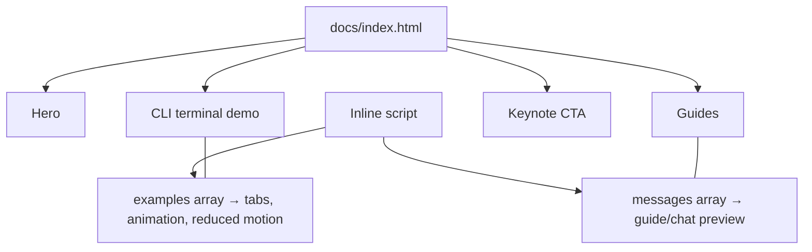

# Landing page: preview and architecture

The static landing page is `docs/index.html`; its images are alongside it. There
is no build step or separate JavaScript bundle.

## Preview locally

From the repository root, start Python's static file server:

```sh
python3 -m http.server --directory docs 8000
```

Open <http://localhost:8000> in a browser. Stop the server with Ctrl+C.

GitHub Pages can publish this same directory without a build: in the repository
settings, configure **Pages** to deploy from the `main` branch and select
`/docs` as the folder. A push to that branch updates the published static site;
the Pages settings show its URL and deployment status.

## Page structure and behavior

- **Hero:** introduces the workshop and links to the Copilot app.
- **CLI terminal demo:** the first terminal view is in the HTML. The inline
  script's `examples` array contains that view and the other CLI examples; tabs
  select them, and the script animates their text and cycles through them.
  Replay and pause controls are available when motion is allowed. With
  `prefers-reduced-motion: reduce`, examples are shown immediately and the pause
  control is hidden.
- **Guides and chat preview:** the four guide disclosures appear in order:
  Skills, Tools and connectors, Security review, and Automate. The inline
  script's `messages` array uses the same order, so opening a guide updates the
  illustrative conversation and its steps.
- **Keynote CTA:** the final section links to the GitHub Universe keynote
  highlights.

Both demos' behavior is implemented in the inline `<script>` in `index.html`.
The diagram shows how the page sections relate to that script:



## Copilot app canvases and tests

Copilot app canvas extensions live under `.github/extensions/*`. For example,
the welcome canvas is in `.github/extensions/universe-welcome/`, and the cheat
sheet canvas is in `.github/extensions/universe-cheatsheet-artifact/`. They are
separate from the static landing page. From the repository root, run the
existing Node.js tests with:

```sh
node --test
```

## Security lab fixture

`security-lab/` contains intentional security-training fixtures. It is not
landing-page content and must not be linked from the site.
